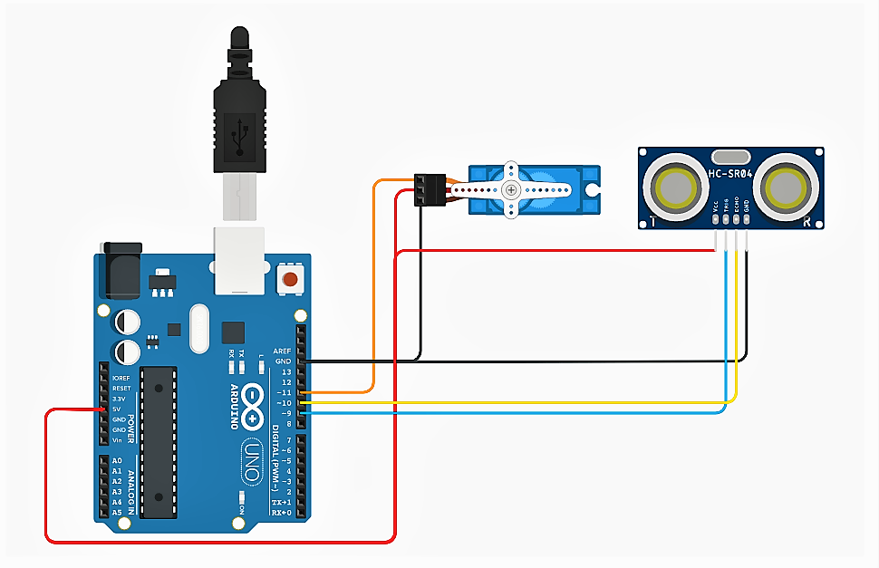

# The EchoHunter — Arduino ultrasonic radar

A servo sweeps an HC-SR04 ultrasonic sensor from 0° to 180° and back, measuring distance at every degree — turning one distance sensor into a radar.

## Hardware

| Part | Pin |
|---|---|
| Arduino Uno | — |
| Servo (signal) | 9 |
| HC-SR04 trig | 10 |
| HC-SR04 echo | 11 |

## How it works

1. The servo steps 1° at a time, pausing 15 ms per step.
2. At each angle the Arduino sends a 10 µs pulse on `trig` and times the echo with `pulseIn`.
3. Distance (cm) = duration × 0.034 / 2 — sound travels ≈ 0.034 cm/µs, halved for the round trip.
4. Each reading goes out over serial at 9600 baud as `angle,distance` for a radar-style visualizer.

## Run it

1. Wire it as above and open `RADAR.ino` in the Arduino IDE.
2. Upload to the Uno.
3. Open the Serial Monitor at 9600 baud to see `angle,distance` lines.

## Limits

- `delay()` and `pulseIn()` block the loop, which caps the sweep speed.
- Distances are whole centimetres with no filtering, so soft or angled surfaces read noisily.
